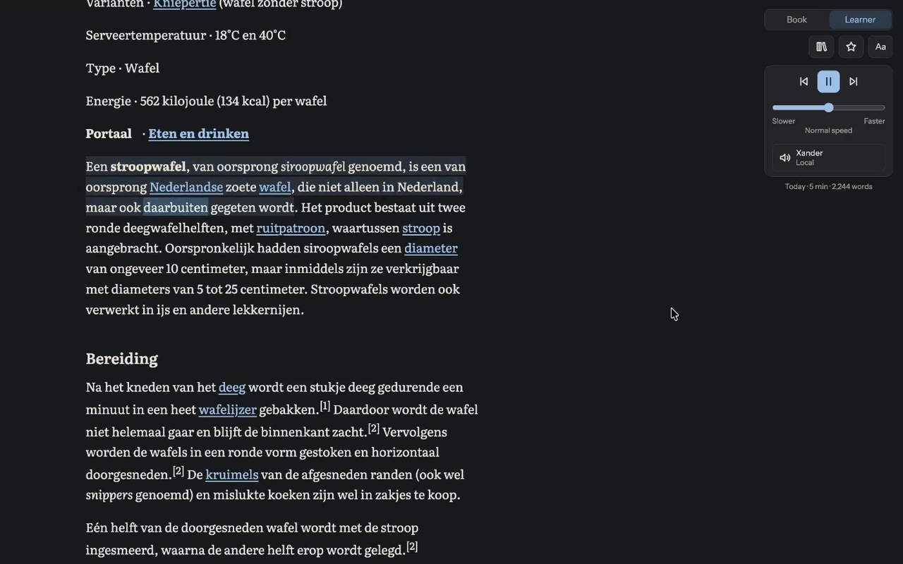
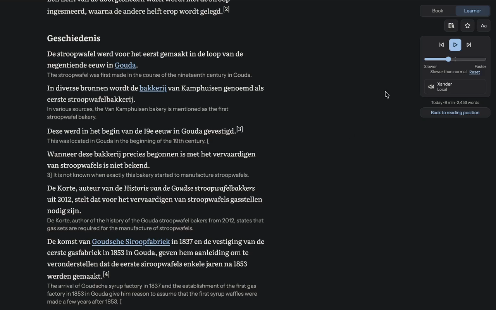
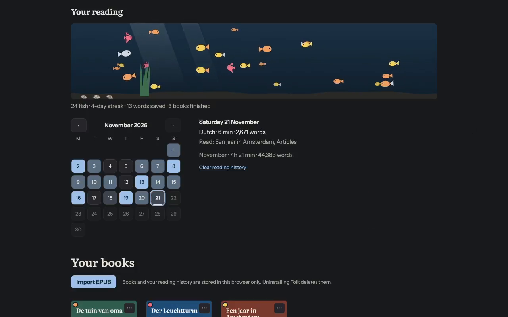

# Tolk

Read real articles and books in the language you're learning, with everything running on your own machine.

*Tolk* is Dutch for "interpreter".

Tolk is a free Chrome extension for people who can read authentic text in another language, but slowly and with gaps. Open a web article or an EPUB book in it, and it reads the text aloud and highlights each word as it's spoken, at a speed that suits you. It translates what you select, and keeps the words you want to remember.

[Watch the 90-second introduction on YouTube](https://youtu.be/nAt9-FO5FM4)



## Features

- **A clean reader** for the article on the current page, or for EPUB books you import into a library
- **Read-along:** read-aloud that highlights the current word and sentence, with a fine speed slider that goes down to slow speeds
- **Translation** of a word, a phrase or a whole paragraph, shown as a line under each sentence so the original stays in view
- **Saved words,** kept with their translation and the sentence they came from, and exportable to Anki
- **Reading history:** how much you read each day, per language, as a calendar in the library, and an aquarium that gains a fish for each day you read
- Two modes, Book and Learner, and four colour schemes: Light, Sepia, Dark and Dim

Tolk detects the language of the text itself, and you tell it your own language once.

| Translation under each sentence | The library's aquarium and calendar |
| --- | --- |
|  |  |

The screenshots show the Dutch Wikipedia article [“Stroopwafel”](https://nl.wikipedia.org/wiki/Stroopwafel), under [CC BY-SA 4.0](https://creativecommons.org/licenses/by-sa/4.0/), so the screenshots are under that licence too.

## What it needs

- Chrome 138 or later on a desktop computer. Chrome's built-in AI, which Tolk uses for language detection and translation, isn't available on phones.
- For translation, a computer and language pair that Chrome supports. Chrome downloads a language pack the first time you ask, about 80 MB per language. `chrome://on-device-internals` shows what your computer can do.
- For read-along, a voice for the language, either installed on your computer or offered by Chrome.

Languages written right to left, such as Arabic and Hebrew, aren't supported yet. Tolk was built and tested with Dutch, and nothing in it is specific to Dutch.

## Install

Load it unpacked from source:

1. Build it, as described below.
2. Open `chrome://extensions` and turn on Developer mode.
3. Choose *Load unpacked* and select the `extension/` folder.

Then open an article and click Tolk's toolbar icon, or press <kbd>Alt</kbd>+<kbd>Shift</kbd>+<kbd>R</kbd>. Help, from the settings in the reader, explains the rest.

## Privacy

Tolk has no server, account or analytics, and makes no network requests of its own. Detecting the language and translating happen on your computer, and books, saved words and reading history stay in your browser.

Two things can leave your computer, both sent by Chrome: your settings, through Chrome sync, and the text being spoken, if you pick one of Chrome's remote voices. Local voices are the default. [PRIVACY.md](PRIVACY.md) has the full policy.

## Build

Tolk is TypeScript with no framework or bundler. You need Node.js.

```sh
npm install
npx tsc --watch      # compile src/ into extension/js/, and recompile on save
npm run package      # build a clean zip for the Chrome Web Store, in dist/
```

The design is in [`docs/`](docs/): start with the [product spec](docs/product-spec.md) and the [architecture](docs/architecture.md).

## Licence

[Apache-2.0](LICENSE). Bundled fonts and libraries keep their own licences, listed in [`docs/third-party.md`](docs/third-party.md).
